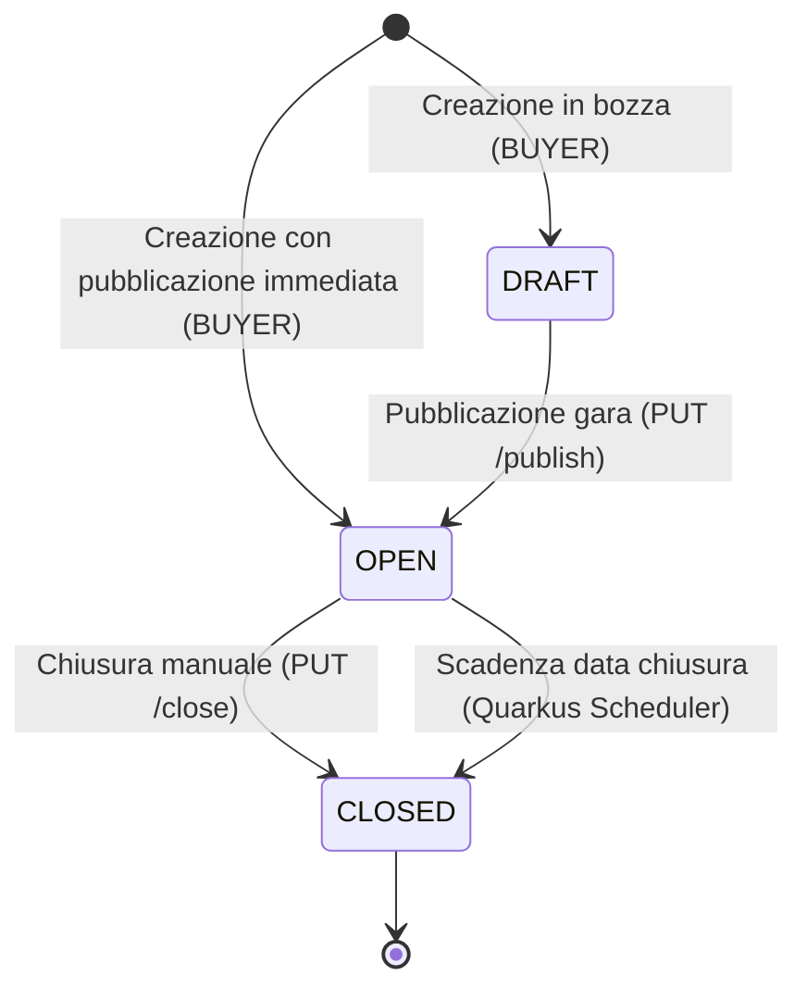
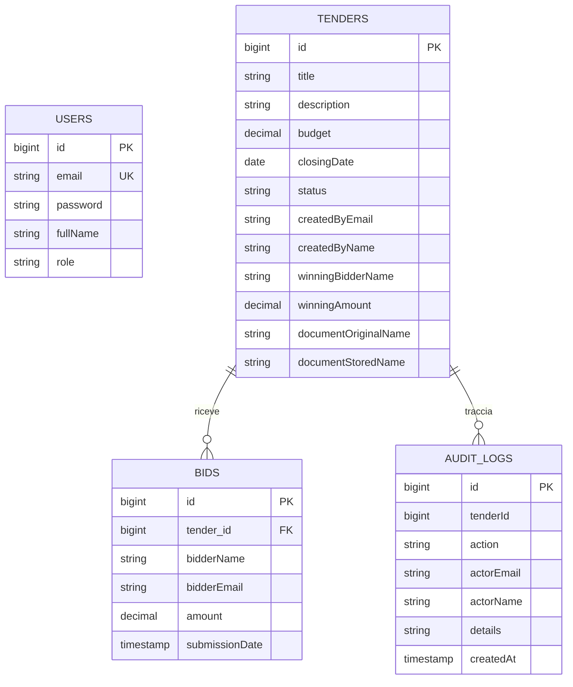

# Analisi Funzionale, Specifica dei Requisiti e Piano di Test UAT — TenderFlow v2.0.0

* **Sistema:** TenderFlow — Enterprise B2B Procurement & e-Tendering Platform
* **Versione Release:** `v2.0.0` (Commercial Ready)
* **Repository:** `TheGreenFogAlpha/ExampleProject`
* **Stack Tecnologico:** Quarkus 3.40 (Java 17) • Angular 22 (Signals) • PostgreSQL 15 • Apache Kafka (KRaft) • Nginx

---

## 1. Contesto, Visione di Prodotto e Obiettivi di Business

**TenderFlow** è una piattaforma B2B di e-Procurement progettata per digitalizzare e rendere verificabile l'intero ciclo di vita delle gare d'appalto con aggiudicazione al minor prezzo. Il sistema supera le inefficienze dei flussi tradizionali frammentati (invio tramite PEC, fogli di calcolo manuali, comunicazioni asincrone non tracciate) offrendo un ambiente centralizzato, reattivo e basato su eventi.

L'architettura funzionale persegue quattro obiettivi primari:

1. **Trasparenza e Immutabilità (Compliance):** ogni operazione rilevante sul ciclo di vita di una gara o di un'offerta viene registrata in un *Audit Trail* cronologico persistente, esportabile in formato CSV strutturato per verifiche ispettive e rendicontazione.
2. **Competitività in Tempo Reale:** l'integrazione tra **Apache Kafka** e **Server-Sent Events (SSE)** consente agli operatori connessi di ricevere aggiornamenti istantanei sulle nuove offerte e sullo stato dei bandi senza ricaricare l'interfaccia, stimolando rilanci competitivi al ribasso.
3. **Segregazione dei Ruoli e Riservatezza:** separazione netta tra *Ente Appaltante* (`BUYER`) e *Fornitore* (`SUPPLIER`), con protezione rigorosa delle gare in fase di predisposizione (`DRAFT`) e verifica di proprietà (*ownership*) su ogni azione critica.
4. **Automazione Operativa e Analitica Decisionale:** chiusura e aggiudicazione automatica delle gare scadute tramite job schedulato giornaliero e calcolo immediato dei KPI di risparmio medio e performance dei fornitori.

> **Architettura d'Accesso (Login Wall & RBAC):** L'interfaccia web applica una barriera d'ingresso obbligatoria: nessun dato di gara, statistica KPI o documento tecnico è accessibile prima dell'autenticazione. Una volta effettuato il login, entrambi i ruoli consultano il catalogo gare pubblicate, le metriche aggregate e i capitolati PDF, mentre le operazioni dispositive sono vincolate al ruolo e alla titolarità della gara.

---

## 2. Attori del Sistema e Matrice dei Permessi (RBAC)

Il modello di autorizzazione si fonda su token **JSON Web Token (JWT)** firmati asimmetricamente con algoritmo RSA (`RS256`, emittente `https://tenderflow.it/issuer`, validità 24 ore). Il token trasporta l'identificativo univoco dell'utente (`upn` = email), il nome dell'organizzazione (`fullName`) e il gruppo di appartenenza (`groups`).

| Attore | Ruolo / Identità | Profilo Funzionale | Operazioni Abilitate |
| :--- | :--- | :--- | :--- |
| **Ente Appaltante** | `BUYER` | Ufficio acquisti, stazione appaltante o direzione procurement che indice e governa le gare. | Creare gare (`DRAFT` o `OPEN`); allegare/sostituire capitolati PDF; pubblicare le proprie bozze; chiudere e aggiudicare manualmente le proprie gare; consultare graduatorie, Audit Trail ed esportare report CSV. |
| **Fornitore** | `SUPPLIER` | Operatore economico o azienda partecipante ai bandi pubblicati sulla piattaforma. | Consultare gare `OPEN` e `CLOSED`; scaricare i capitolati tecnici PDF; presentare offerte economiche iniziali; migliorare al ribasso le proprie offerte attive; monitorare la graduatoria. |
| **Processo Schedulato** | `SYSTEM` (Quarkus Scheduler) | Servizio automatico interno attivo giornalmente alle ore 00:00 (`cron = 0 0 0 * * ?`). | Individuare tutte le gare `OPEN` con data di scadenza superata (`closingDate < oggi`), chiuderle automaticamente e aggiudicarle al miglior offerente registrato. |
| **Seeder Iniziale** | `DemoDataSeeder` | Componente di bootstrap eseguito allo startup (escluso profilo `test`) solo se il DB è vuoto. | Inizializzare 5 organizzazioni B2B (2 Buyer, 3 Supplier), 4 gare negli stati `CLOSED`, `OPEN` e `DRAFT`, 4 offerte storiche e i relativi record di Audit Trail. |

---

## 3. Ciclo di Vita e Macchina a Stati delle Gare

Ogni gara d'appalto (entità `Tender`) attraversa un ciclo di vita governato da tre stati esclusivi: `DRAFT`, `OPEN` e `CLOSED`. Le transizioni sono irreversibili e validate lato server dal controller `TenderResource` e dal servizio transazionale `TenderLifecycleService`.

| Stato | Visibilità | Transizioni in Ingresso / Uscita | Operazioni Ammesse |
| :--- | :--- | :--- | :--- |
| `DRAFT` (Bozza) | Visibile **solo** al `BUYER` creatore (`createdByEmail`). | **Ingresso:** `POST /api/tenders` con `status = DRAFT`. **Uscita:** `PUT /api/tenders/{id}/publish` → `OPEN`. | Upload o sostituzione del capitolato tecnico PDF; pubblicazione della gara. Inibita la presentazione di offerte e la chiusura diretta. |
| `OPEN` (Aperta) | Visibile a tutti gli utenti autenticati (`BUYER` e `SUPPLIER`). | **Ingresso:** creazione diretta `OPEN` oppure pubblicazione da `DRAFT`. **Uscita:** chiusura manuale (`PUT /close`) o scadenza automatica → `CLOSED`. | Upload/aggiornamento capitolato PDF (owner); invio prima offerta e rilancio al ribasso (`SUPPLIER`); consultazione graduatoria; chiusura e aggiudicazione. |
| `CLOSED` (Chiusa) | Visibile a tutti gli utenti autenticati con esito aggiudicazione. | **Ingresso:** chiusura manuale dal Buyer owner oppure job notturno `TenderExpirationScheduler`. **Uscita:** stato terminale definitivo. | Consultazione vincitore e importo aggiudicato; lettura Audit Trail completo (owner); esportazione report ufficiale CSV (owner). Nessuna offerta o modifica ammessa. |

---

## 4. Specifiche Dettagliate dei Casi d'Uso

### UC-01 — Registrazione, Autenticazione e Gestione Sessione
L'utente non autenticato visualizza esclusivamente la schermata di accesso (`AuthComponent`). In fase di registrazione (`POST /api/auth/register`) inserisce Ragione Sociale/Nome completo, Email aziendale, Password e Ruolo (`BUYER` o `SUPPLIER`). Il sistema normalizza l'email in minuscolo, verifica l'assenza di duplicati (restituendo `HTTP 409 Conflict` se già registrata), cifra la password tramite **BCrypt** e restituisce immediatamente il token JWT. Al login (`POST /api/auth/login`) vengono verificate le credenziali cifrate e viene memorizzata la sessione lato client, attivando contestualmente l'interceptor HTTP (`authInterceptor`) per l'iniezione automatica dell'header `Authorization: Bearer <token>` su tutte le richieste verso `/api/*`.

### UC-02 — Creazione Bando e Gestione Capitolato Tecnico PDF
Un utente con ruolo `BUYER` può creare una nuova gara tramite `POST /api/tenders` specificando titolo, descrizione tecnica, budget massimo a base d'asta (€), data facoltativa di chiusura (`closingDate`) e stato iniziale (`OPEN` di default oppure `DRAFT`). Se creata in stato `OPEN`, la gara viene immediatamente pubblicata sul topic Kafka `tender-events`. Sia in stato `DRAFT` sia in stato `OPEN`, il Buyer proprietario può allegare o sostituire un documento PDF tramite `POST /api/tenders/{id}/document` (`multipart/form-data`): il servizio `DocumentStorageService` valida l'estensione `.pdf`, la dimensione massima di **10 MB** e i magic bytes iniziali `%PDF-`, archiviando il file con identificativo UUID e rimuovendo l'eventuale versione precedente. Tutti gli utenti autenticati possono consultare il PDF inline tramite `GET /api/tenders/{id}/document`.

### UC-03 — Ricerca Avanzata, Filtri Combinati e Dashboard Analitica KPI
La dashboard principale integra un pannello analitico (`AnalyticsDashboardComponent` alimentato da `GET /api/tenders/stats`) che calcola dinamicamente su tutte le gare aggiudicate:
* **Gare Attive (OPEN) e Budget Attivo:** conteggio delle gare aperte rispetto al totale e somma dei relativi budget a base d'asta.
* **Volume Aggiudicato:** somma degli importi vincenti (`winningAmount`) sulle gare chiuse con aggiudicatario.
* **Risparmio Medio Aste (%) e Risparmio Totale (€):** differenza tra base d'asta e importo di aggiudicazione, calcolata sia in valore assoluto sia come media percentuale sui bandi aggiudicati.
* **Classifica Top Fornitori:** graduatoria dei primi 5 fornitori ordinati per numero di gare vinte e volume totale aggiudicato.

L'elenco gare (`GET /api/tenders`) supporta filtri combinati lato server per parola chiave nel titolo (*case-insensitive*), stato (`DRAFT`, `OPEN`, `CLOSED`), fascia di budget (`minBudget`, `maxBudget`), ordinamento dinamico (`id`, `budget`, `title`, `closingDate`) e paginazione (`page`, `size`).

### UC-04 — Sottomissione Offerte e Meccanismo di Rilancio al Ribasso
Un utente con ruolo `SUPPLIER` può partecipare a qualsiasi gara in stato `OPEN` la cui data di scadenza non sia trascorsa, inviando un'offerta economica tramite `POST /api/tenders/{tenderId}/bids`. Il sistema applica le seguenti regole deterministiche:
1. **Validazione Importo e Budget:** l'offerta deve essere maggiore di zero e non può eccedere il budget massimo della gara (`amount <= tender.budget`).
2. **Unicità dell'Offerta e Rilancio Migliorativo:** ogni fornitore mantiene un'unica offerta attiva per gara. Se il fornitore ha già sottomesso un'offerta sulla medesima gara, il sistema verifica che il nuovo importo sia **strettamente inferiore** al precedente (`nuovoImporto < offertaAttuale`); in caso contrario respinge l'operazione con errore esplicativo.
3. **Aggiornamento Graduatoria & Streaming Real-Time:** l'offerta viene persistita, tracciata nell'Audit Trail (`BID_SUBMITTED` o `BID_UPDATED`) e pubblicata sul topic Kafka `bid-events`. La graduatoria (`GET /api/tenders/{tenderId}/bids`) ordina automaticamente le offerte per importo crescente (`sortBy=amount&sortOrder=asc`).

### UC-05 — Chiusura, Aggiudicazione al Minor Prezzo e Scheduler Automatico
La chiusura di una gara `OPEN` può avvenire in due modalità gestite centralmente da `TenderLifecycleService.closeAndAwardTender`:
* **Chiusura Manuale (`PUT /api/tenders/{id}/close`):** attivata dal Buyer proprietario. Il sistema verifica l'ownership, imposta lo stato su `CLOSED` e seleziona l'offerta con importo minimo (`ORDER BY amount ASC`). Se esistono offerte, valorizza `winningBidderName` e `winningAmount`; in assenza di offerte chiude la gara senza aggiudicatario.
* **Chiusura Automatica Schedulata (`TenderExpirationScheduler`):** eseguita ogni giorno a mezzanotte; individua tutte le gare `OPEN` con `closingDate < LocalDate.now()` e applica la medesima procedura di aggiudicazione registrando l'attore di sistema `Quarkus Scheduler`.

### UC-06 — Audit Trail Cronologico ed Export Report Ufficiale CSV
Per ogni gara, il Buyer proprietario dispone di una vista di tracciabilità completa (`GET /api/tenders/{id}/audit`) che espone in ordine cronologico inverso tutte le azioni eseguite (`CREATED`, `PUBLISHED`, `DOCUMENT_UPLOADED`, `BID_SUBMITTED`, `BID_UPDATED`, `CLOSED_MANUAL`, `CLOSED_SCHEDULER`) con indicazione di data/ora, attore (nome ed email) e dettaglio dell'operazione. Tramite `GET /api/tenders/{id}/report.csv` il Buyer può scaricare un file CSV codificato `UTF-8 con BOM` (separatore punto e virgola per compatibilità diretta con Microsoft Excel) strutturato in tre sezioni: *Riepilogo Gara d'Appalto*, *Graduatoria Offerte* e *Audit Trail Operazioni*.

---

## 5. Modello Dati Relazionale

La persistenza è gestita tramite Hibernate ORM con Panache su **PostgreSQL 15** (e database in-memory H2 nel profilo di test).

| Tabella / Entità | Attributi Principali | Chiavi e Vincoli | Descrizione Funzionale |
| :--- | :--- | :--- | :--- |
| `users` (`User`) | `id`, `email`, `password`, `fullName`, `role` | PK: `id`; Unique & Not Null: `email` | Anagrafica utenti registrati. La password è memorizzata esclusivamente come hash BCrypt; `role` assume valore `BUYER` o `SUPPLIER`. |
| `tenders` (`Tender`) | `id`, `title`, `description`, `budget`, `closingDate`, `status`, `createdByEmail`, `createdByName`, `winningBidderName`, `winningAmount`, `documentOriginalName`, `documentStoredName` | PK: `id`; Stati: `DRAFT`, `OPEN`, `CLOSED` | Entità centrale del bando di gara. Conserva i riferimenti del Buyer creatore, l'esito dell'aggiudicazione e i metadati del capitolato PDF. |
| `bids` (`Bid`) | `id`, `tender_id`, `bidderName`, `bidderEmail`, `amount`, `submissionDate` | PK: `id`; FK: `tender_id` → `tenders.id` | Offerte economiche presentate dai fornitori su una gara. Relazione N:1 verso `tenders` con fetch eager. |
| `audit_logs` (`AuditLog`) | `id`, `tenderId`, `action`, `actorEmail`, `actorName`, `details`, `createdAt` | PK: `id`; Indice logico: `tenderId` | Registro storico append-only di tutte le operazioni eseguite sulle gare e sulle offerte per finalità di audit e compliance. |

---

## 6. Catalogo Regole di Business e Vincoli di Integrità

Tutte le eccezioni funzionali vengono intercettate da `GlobalExceptionMapper` e restituite al client secondo un contratto JSON uniforme (`ErrorResponse`: `status`, `error`, `message`, `timestamp`):

| Codice | Regola di Business | Esito Violazione | Componente |
| :--- | :--- | :--- | :--- |
| **BR-01** | L'importo di un'offerta deve essere strettamente positivo e non può superare il budget massimo della gara (`0 < amount <= budget`). | `HTTP 400 Bad Request` | `BidResource` |
| **BR-02** | Le offerte sono ammesse esclusivamente su gare in stato `OPEN` e con `closingDate` non ancora superata. | `HTTP 400 Bad Request` | `BidResource` |
| **BR-03** | Un fornitore può avere una sola offerta per gara; un successivo invio è consentito solo se migliorativo al ribasso (`newAmount < currentAmount`). | `HTTP 400 Bad Request` | `BidResource` |
| **BR-04** | Solo il `BUYER` creatore della gara può pubblicarla, caricare documenti, chiuderla, consultare l'Audit Trail o esportare il CSV. | `HTTP 403 Forbidden` | `TenderResource` |
| **BR-05** | Una gara in stato `DRAFT` non può essere chiusa direttamente; una gara `CLOSED` non può essere ripubblicata o richiusa. | `HTTP 400 Bad Request` | `TenderResource` |
| **BR-06** | I documenti allegati devono avere estensione `.pdf`, dimensione `<= 10 MB` e header binario valido `%PDF-`. | `HTTP 400 Bad Request` | `DocumentStorageService` |
| **BR-07** | In fase di aggiudicazione vince automaticamente l'offerta con importo minimo (`MIN(amount)`). | Aggiudicazione deterministica | `TenderLifecycleService` |

---

## 7. Architettura Event-Driven, Sicurezza e Requisiti Non Funzionali

* **Flusso Asincrono Apache Kafka + SSE:** Alla creazione/pubblicazione/chiusura di una gara (topic `tender-events`) o alla ricezione/rilancio di un'offerta (topic `bid-events`), i consumer `TenderConsumer` e `BidConsumer` inoltrano un evento `LiveEvent` a `EventBroadcaster` (basato su `BroadcastProcessor` di SmallRye Mutiny). L'endpoint `GET /api/events/stream` fonde gli eventi reali con un segnale di keep-alive `PING` ogni 25 secondi per prevenire il timeout delle connessioni HTTP/1.1 attraversate da Nginx (`proxy_buffering off`, `proxy_read_timeout 3600s`).
* **Hardening e Protezione Storage:** Oltre alla firma asimmetrica JWT RS256 (con percorsi chiavi configurabili tramite variabili d'ambiente `JWT_PUBLIC_KEY_LOCATION` e `JWT_PRIVATE_KEY_LOCATION`) e al limite massimo del payload HTTP impostato a 12 MB, `DocumentStorageService` previene attacchi di *Path Traversal* normalizzando il percorso assoluto e verificando `targetPath.startsWith(directory)`.
* **Orchestrazione Container & Qualità del Codice:** Lo stack è distribuito tramite Docker Compose in quattro servizi isolati (`postgres`, `kafka` in modalità KRaft senza ZooKeeper, `backend` e `frontend`) con healthcheck su database e broker e volumi persistenti (`postgres_data`, `kafka_data`, `uploads_data`). La suite di verifica include test di integrazione backend (JUnit 5 + REST Assured + H2 + SmallRye In-Memory Messaging) e test unitari/componente frontend (Vitest), eseguiti automaticamente dalla pipeline GitHub Actions.

---

## 8. Piano di Test Funzionali (User Acceptance Testing — UAT)

Il piano di collaudo funzionale verifica end-to-end tutti i flussi operativi, i vincoli di sicurezza RBAC/ownership e le regole di business sull'ambiente containerizzato (`http://localhost:4200` e `http://localhost:4200/q/swagger-ui/`), utilizzando il dataset generato automaticamente da `DemoDataSeeder` (password comune: `TenderFlow2026!`) e il documento facsimile `Capitolato_Tecnico_Cybersecurity_2026.pdf`.

| ID | Modulo | Caso di Test & Ruolo | Precondizioni e Passi Operativi | Risultato Atteso |
| :--- | :--- | :--- | :--- | :--- |
| **TF-01** | Autenticazione | **Accesso riservato (Login Wall)** *Ruolo:* Anonimo | **Pre:** Nessuna sessione attiva. 1. Aprire `http://localhost:4200`. | Viene mostrata esclusivamente la schermata di Login/Registrazione; gare, PDF e KPI restano inaccessibili senza autenticazione. |
| **TF-02** | Autenticazione | **Login con credenziali errate e valide** *Ruolo:* Buyer / Supplier | **Pre:** Dataset demo attivo. 1. Tentare login con password errata. 2. Accedere con `procurement@comune-milano.it` / `TenderFlow2026!`. | 1. Errore *"Credenziali non valide"* (`HTTP 401`). 2. Rilascio token JWT RS256, apertura stream SSE e caricamento dashboard. |
| **TF-03** | Dashboard KPI | **Verifica metriche aggregate iniziali** *Ruolo:* Buyer / Supplier | **Pre:** Utente autenticato sul dataset iniziale. 1. Osservare le 4 card KPI e la barra Top Fornitori. | 2 Gare Attive (`OPEN`) su 4 totali, Budget attivo `€ 365.000`, Volume Aggiudicato `€ 154.500`, Risparmio Medio `14,17%` (`€ 25.500`), `#1 CloudItalia Sistemi S.p.A.`. |
| **TF-04** | Segregazione RBAC | **Visibilità gare in bozza (`DRAFT`)** *Ruolo:* Buyer 1 vs Buyer 2 / Supplier | **Pre:** Gara `DRAFT` *"Audit Cybersecurity..."* creata da Buyer 1. 1. Verificare elenco gare come Buyer 1. 2. Verificare elenco gare in incognito come Supplier 1 o Buyer 2. | 1. Buyer 1 visualizza la gara `DRAFT` con badge *Tua Gara*. 2. Supplier e Buyer 2 non visualizzano alcuna gara in stato `DRAFT`. |
| **TF-05** | Gestione Allegati | **Upload, validazione e download PDF** *Ruolo:* Buyer 1 (Owner) | **Pre:** Gara `DRAFT` selezionata. 1. Tentare upload di file non PDF. 2. Caricare `Capitolato_Tecnico_Cybersecurity_2026.pdf`. 3. Cliccare sul badge del file allegato. | 1. Blocco immediato (`HTTP 400`, validazione estensione e magic bytes `%PDF-`). 2. Salvataggio su storage, evento `DOCUMENT_UPLOADED` registrato e apertura inline del PDF. |
| **TF-06** | Ciclo di Vita Gara | **Pubblicazione gara (`DRAFT` → `OPEN`)** *Ruolo:* Buyer 1 (Owner) | **Pre:** Gara in stato `DRAFT` aperta nei dettagli. 1. Cliccare su **Pubblica Gara (OPEN)**. | Stato aggiornato a `OPEN`, KPI *Gare Attive* sale a `3`, evento `PUBLISHED` registrato nell'Audit Trail e gara visibile ai Supplier. |
| **TF-07** | Offerte & Rilanci | **Prima offerta e rilancio al ribasso** *Ruolo:* Supplier 1 (`offerte@techsolutions.it`) | **Pre:** Gara `OPEN` con budget `€ 65.000`. 1. Inviare `70000` € (sopra budget). 2. Inviare `58000` € (prima offerta). 3. Inviare `59000` € (peggiorativa). 4. Inviare `54500` € (rilancio al ribasso). | 1. Blocco sopra budget (`HTTP 400`). 2. Offerta registrata (`BID_SUBMITTED`). 3. Blocco: *"Puoi solo migliorarla al ribasso"* (`HTTP 400`). 4. Offerta aggiornata a `€ 54.500` (`BID_UPDATED`). |
| **TF-08** | Real-Time Streaming | **Aggiornamento live Kafka + SSE** *Ruolo:* Buyer 1 + Supplier 1 | **Pre:** Due finestre affiancate sulla stessa gara `OPEN`. 1. Supplier 1 invia o rilancia un'offerta. 2. Osservare la finestra di Buyer 1 senza ricaricare. | Comparsa immediata della notifica toast SSE e aggiornamento automatico della tabella *Offerte Ricevute* e dell'*Audit Trail*. |
| **TF-09** | Aggiudicazione | **Chiusura manuale e calcolo vincitore** *Ruolo:* Buyer 1 (Owner) | **Pre:** Gara `OPEN` con offerta minima `€ 54.500`. 1. Cliccare su **Chiudi e Aggiudica Gara**. | Gara passa a `CLOSED`, aggiudicata a `TechSolutions Enterprise S.r.l.` per `€ 54.500`; Volume Aggiudicato sale a `€ 209.000` e aggiornamento Top Fornitori. |
| **TF-10** | Sicurezza Ownership | **Tentativo operazioni su gara altrui** *Ruolo:* Buyer 2 (`gare@infrastrutture-italia.it`) | **Pre:** Gara creata da Buyer 1. 1. Tentare chiamate `PUT /close`, `GET /audit` o `GET /report.csv` sulla gara di Buyer 1 via API/Swagger. | Operazione respinta con `HTTP 403 Forbidden` (*"Operazione non consentita: non sei il proprietario di questa gara"*). |
| **TF-11** | Audit & Report | **Verifica Audit Trail ed Export CSV** *Ruolo:* Buyer 1 (Owner) | **Pre:** Gara chiusa dopo upload, pubblicazione, offerte e aggiudicazione. 1. Controllare timeline Audit Trail. 2. Cliccare su **Esporta Report CSV**. | 1. Presenti tutti gli eventi in ordine cronologico inverso (`CLOSED_MANUAL`, `BID_UPDATED`, `BID_SUBMITTED`, `PUBLISHED`, `DOCUMENT_UPLOADED`, `CREATED`). 2. Download `report-gara-4.csv` (`UTF-8 BOM`) con 3 sezioni complete. |
| **TF-12** | Automazione | **Chiusura automatica gare scadute** *Ruolo:* Sistema (`Quarkus Scheduler`) | **Pre:** Gara `OPEN` con `closingDate < oggi`. 1. Esecuzione job schedulato giornaliero. | Gara chiusa automaticamente (`CLOSED_SCHEDULER`) e aggiudicata al miglior offerente se presente. |